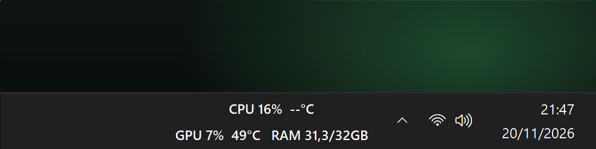
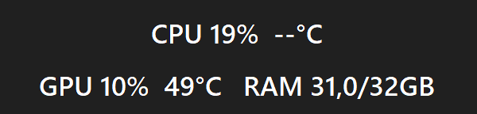

<p align="center">
  
</p>

<p align="center">
  <a href="https://github.com/Vincisus/MicroMonitor/releases/latest"></a>
  
  
  <a href="https://paypal.me/dammilpizzo"></a>
</p>

<h3 align="center">
  <a href="https://github.com/Vincisus/MicroMonitor/releases/latest">⬇&nbsp; Scarica MicroMonitor per Windows</a>
</h3>

<p align="center">
  Due righe di testo nella barra delle applicazioni, subito a sinistra della freccia delle icone nascoste:<br>
  uso e temperatura di CPU e GPU, e la RAM occupata. Si aggiorna ogni 2 secondi, non apre finestre<br>
  e non serve installarlo: è un solo file <code>.exe</code>.
</p>

<br>

<p align="center">
  
</p>

<br>

## Avvia MicroMonitor in 6 passi

**1. Scarica il programma.** Apri la pagina [**Ultima versione**](https://github.com/Vincisus/MicroMonitor/releases/latest) e, sotto *Assets*, clicca **`MicroMonitor.exe`** (circa 70 MB, dentro c'è già tutto quello che gli serve).

**2. Dagli una cartella fissa.** Crea `C:\MicroMonitor` e sposta lì il file. Da quella cartella partirà anche l'avvio automatico del passo 5.

**3. Avvialo con un doppio clic.** Windows può mostrare *«PC protetto da Windows»*, perché il file non ha una firma a pagamento. Clicca **Ulteriori informazioni** e poi **Esegui comunque**. Il widget compare nella barra, a sinistra della freccia `^`.

**4. Accendi le temperature della CPU.** Senza permessi di amministratore la CPU mostra `--°C`. Chiudi il widget, fai clic destro su `MicroMonitor.exe` e scegli **Esegui come amministratore**.

**5. Fallo partire con Windows.** Apri PowerShell **come amministratore** e incolla:

```powershell
schtasks /create /tn "MicroMonitor" /tr "C:\MicroMonitor\MicroMonitor.exe" /sc onlogon /rl highest /f
```

Così parte a ogni accesso, già con i permessi del passo 4. Per avviarlo subito senza riavviare: `schtasks /run /tn "MicroMonitor"`.

**6. Per chiuderlo** fai clic destro sulle scritte del widget e scegli **Esci**.

Fatto: da qui in poi non devi più toccarlo.

<br>

## Cosa mostra

<table>
  <tr>
    <td width="55%" valign="middle">
      
    </td>
    <td valign="middle">

| Riga | Cosa leggi |
|---|---|
| **CPU** | uso totale in % e temperatura del processore |
| **GPU** | uso del core in % e temperatura della scheda video |
| **RAM** | GB occupati sul totale installato |

I sensori arrivano da [LibreHardwareMonitor](https://github.com/LibreHardwareMonitor/LibreHardwareMonitor), quindi funziona con processori Intel e AMD e con schede NVIDIA, AMD e Intel.
    </td>
  </tr>
</table>

<br>

## Segue la barra, anche quando si nasconde

<p align="center">
  
</p>

Se la barra è a scomparsa automatica, MicroMonitor sale e scende con lei, fotogramma per fotogramma, e sparisce quando lei sparisce. Sta sempre sopra le altre finestre, ma non ruba mai il focus e non compare tra i programmi aperti.

<br>

## Impostazioni

Al primo avvio MicroMonitor crea questo file:

```text
%LOCALAPPDATA%\MicroMonitor\settings.json
```

```json
{
  "RefreshIntervalMs": 2000,
  "ShowCpuTemperature": true,
  "ShowGpuTemperature": true
}
```

`RefreshIntervalMs` è ogni quanto si aggiornano i numeri, in millisecondi (da 500 a 10000). Salva il file e riavvia il widget per applicare la modifica.

<br>

## Cosa serve

| | |
|---|---|
| **Sistema** | Windows 10 o 11, 64 bit |
| **.NET** | nessuno da installare: è già dentro l'`.exe` |
| **Spazio su disco** | circa 70 MB |
| **Permessi** | normali; da amministratore per la temperatura della CPU |
| **Barra delle applicazioni** | in basso, tema scuro (il testo è bianco) |

<br>

## Domande frequenti

<details>
<summary><b>Windows dice che l'app potrebbe essere pericolosa. È normale?</b></summary>
<br>
Sì. SmartScreen avvisa per i programmi senza una firma digitale a pagamento. Clicca <b>Ulteriori informazioni › Esegui comunque</b>. Il codice è tutto in questo repository, sono meno di 600 righe.
</details>

<details>
<summary><b>La CPU mostra <code>--°C</code>.</b></summary>
<br>
Per leggere la temperatura del processore LibreHardwareMonitor ha bisogno dei permessi di amministratore. Avvialo con <b>Esegui come amministratore</b>, oppure crea l'avvio automatico del passo 5, che lo fa già. Se resta <code>--°C</code>, la scheda madre non espone il sensore.
</details>

<details>
<summary><b>Non vedo il widget.</b></summary>
<br>
Controlla che la barra sia visibile: con la scomparsa automatica il widget compare solo quando la barra sale. Se è già in esecuzione una copia, la seconda si chiude da sola. Con il tema chiaro di Windows il testo bianco si legge poco: usa il tema scuro in <i>Impostazioni › Personalizzazione › Colori</i>.
</details>

<details>
<summary><b>Pesa sul PC?</b></summary>
<br>
Poco: legge i sensori ogni 2 secondi e ridisegna due righe di testo. Se vuoi ancora meno, alza <code>RefreshIntervalMs</code> nelle impostazioni.
</details>

<details>
<summary><b>Funziona con più monitor?</b></summary>
<br>
Il widget sta sulla barra del monitor principale.
</details>

<details>
<summary><b>Come lo tolgo del tutto?</b></summary>
<br>
Fai clic destro sul widget › <b>Esci</b>. Se hai creato l'avvio automatico, da PowerShell come amministratore: <code>schtasks /delete /tn "MicroMonitor" /f</code>. Poi cancella la cartella <code>C:\MicroMonitor</code> e, se vuoi, <code>%LOCALAPPDATA%\MicroMonitor</code>.
</details>

<br>

## Per chi sviluppa

È un'app WinForms in C# per .NET 8. Il widget è una finestra senza bordi con lo sfondo trasparente, agganciata alla barra con `SetWinEventHook`; i sensori arrivano da `LibreHardwareMonitorLib`.

| File | Cosa fa |
|---|---|
| `Program.cs` | avvio, una sola copia alla volta |
| `WidgetForm.cs` | la finestra, la posizione sulla barra e il disegno delle due righe |
| `HardwareMonitor.cs` | CPU e GPU: uso e temperature |
| `MemoryMonitor.cs` | RAM occupata e totale |
| `SettingsManager.cs` | `settings.json` in `%LOCALAPPDATA%\MicroMonitor` |

Serve il [.NET 8 SDK](https://dotnet.microsoft.com/download/dotnet/8.0) (`winget install Microsoft.DotNet.SDK.8`).

```powershell
dotnet run -c Release                    # prova al volo
dotnet publish -c Release -r win-x64 --self-contained true -p:PublishSingleFile=true -p:EnableCompressionInSingleFile=true -p:IncludeNativeLibrariesForSelfExtract=true -o publish
```

Il secondo comando crea `publish\MicroMonitor.exe`, lo stesso file che va allegato a una nuova release `vX.Y.Z`.

<br>

## Sostieni MicroMonitor

MicroMonitor è gratis e resta gratis. Se ti è utile, puoi offrire un caffè a chi lo sviluppa: aiuta a pagare il tempo per le prossime versioni.

<p align="center">
  <a href="https://paypal.me/dammilpizzo"></a>
</p>

<br>

<p align="center"><sub>MicroMonitor usa <a href="https://github.com/LibreHardwareMonitor/LibreHardwareMonitor">LibreHardwareMonitor</a> (MPL 2.0) per leggere i sensori.</sub></p>
